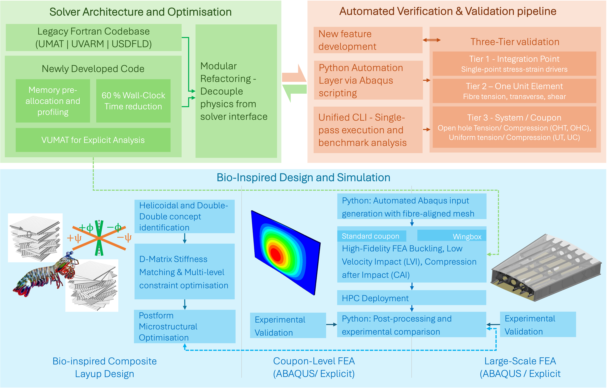

# Imperial College London — Research Associate

**Industry Partners:** Short Brothers (Spirit AeroSystems) & Airbus — ATI Project  
💼 Research Associate, Simulation Engineer  
📍 London, UK  
🗓️ Nov. 2024 – present

I build physics-based simulations of damage in composite aerostructures and check them against physical tests. The work covers the whole chain: the material model and the solver code, the large-structure finite element (FE) models that use them, the automated pipelines that run them on HPC, and the validation that decides whether a result can be trusted. The project uses these tools to design bio-inspired laminates with better impact damage tolerance.

  

---

## 1. Physics-Based Damage Modelling

- **Ply-by-ply impact and residual-strength models:** Built detailed ply-by-ply FE models for low-velocity impact (LVI) and compression after impact (CAI) using the LaRC05 failure model. The models capture the three damage modes that govern these events: intralaminar matrix cracking, fibre failure and interlaminar delamination. Because every ply is resolved, the models show *where* damage sits through the thickness, not only how large it is.
- **Full damage sequence:** Simulated the complete non-linear sequence of buckling, impact and compression after impact. The impact damage state is transferred into the compression model so that residual strength is computed on the damaged structure.
- **Physically motivated imperfections:** Introduced geometric perturbations into the CAI models to represent real manufacturing imperfections (see Section 3). A perfectly ideal model over-predicts compressive strength.

## 2. Making Large-Structure Models Run Reliably

- **Element distortion control:** Developed and verified distortion-control checks for explicit analysis, including Jacobian and maximum-shear checks, so that heavily damaged elements do not stop the analysis or produce non-physical results.
- **Meshing for accuracy and cost:** Used fibre-aligned meshing and tuned localised mesh refinement so that resolution goes where damage develops and the rest of the model stays affordable. Tuned integration schemes and hourglass control to keep explicit solutions accurate and stable.
- **Stable time increment awareness:** In explicit analysis, the smallest element sets the time increment for the whole model. When a direct submission of a sub-element model requested more than a week of run time, I traced the cause to small elements in the noodle (radius-filler) region. That region is not critical for the failure being studied, so I changed the meshing strategy there and brought the run time back within a practical range. I now check the stable time increment of large models before submitting them.

## 3. Validation and Error Diagnosis

I treat a mismatch with a test as a question about physics, not only about parameters. Three examples:

- **Stiffness vs. strength in CAI:** The simulated CAI stiffness differed from the test curves. I traced the difference to machine compliance included in the measured displacement, so it was not a modelling error. The predicted *peak* load, however, was too high. I concluded that the model was "too perfect". Adding a small perturbation as a physical imperfection gave a better prediction of CAI strength.
- **Checking a predicted failure against the evidence:** A sub-element simulation predicted perforation. Published experimental studies and the available test evidence pointed to a different failure behaviour. To handle this uncertainty, I proposed a **multi-fidelity approach**: a sub-stack model gives a lower bound and the ply-by-ply model gives an upper bound, so the true response can be bracketed.
- **Correlation with experiments:** Correlated simulation with tests across several designs. Showed that novel helicoidal designs give a **6% increase in mechanical properties** at the same weight and stability as the industry baseline.

## 4. Solver Software Architecture and Performance

- **Modular material library:** Re-architected the legacy Fortran finite element subroutines (UMAT, UVARM, USDFLD) into a modular library and developed a VUMAT subroutine for explicit dynamics. The material physics (LaRC05) is now separate from the solver interfaces. New features can be prototyped as "plug-and-play" modules, and the code is easier to extend and maintain.
- **Memory and run-time optimisation:** Profiled the VUMAT and refactored its variable assignment and memory allocation. A memory pre-allocation strategy for homogeneous cases balanced memory use against CPU time and cut simulation wall-clock time by **60%** compared with the legacy implementation.

## 5. Automated Verification and Validation (V&V)

A Python test framework checks every change to the material code at three scales:

- **Integration point:** single-point test drivers compare new constitutive features with theoretical stress–strain paths.
- **Single element:** automated single-element tests check the response in each primary loading mode (fibre tension, transverse tension, shear).
- **Coupon:** automated comparison with industry-standard tests: open-hole tension (OHT), open-hole compression (OHC), unnotched tension (UT) and unnotched compression (UC).

One **command-line interface (CLI)** runs a single test or the full suite in one pass and compares the results with the benchmarks automatically. This keeps the code consistent throughout development.

## 6. Simulation Pipeline and HPC

- **Automated model generation:** Python scripts for Abaqus generate models with fibre-aligned meshes and update parameters automatically, from coupons up to wingbox sub-structures and stringer run-outs.
- **Cluster submission and monitoring:** Automated submission of large jobs to HPC clusters, with **energy-balance checks** that flag problems early instead of after days of run time.
- **Impact-to-compression state transfer:** Transferred state variables between the impact simulation and the post-impact compression simulation, so the two analyses run as one chain.
- **Faster post-processing:** Reduced the size of output (ODB) files after each run, which made data extraction and visualisation much faster.
- **Results dashboard:** Built a dashboard for browsing and comparing results across designs and load cases.

## 7. Bio-Inspired Laminate Design

- **Stiffness-matched layup optimisation:** Wrote a Python optimisation tool that finds bio-inspired helicoidal and Double-Double (DD) layups matching the bending stiffness ("D-matrix") of the baseline laminate. Multi-level constraints keep the new designs equivalent to the baseline, so any change in damage tolerance comes from the layup architecture itself.

## 8. Project Leadership

- **Technical lead** for the Imperial part of the ATI project: managed communication between teams, financial planning and technical deliverables.
- **Supervision:** supervised two PhD students in algorithm development and computational mechanics.

---

## Research Vision

My work points to three connected goals for FE structural analysis:

- **More accurate:** embed physics in both conventional FE models and data-driven surrogates, so predictions generalise to new designs instead of only fitting known ones. Choosing what to predict is part of this: my results show that residual strength depends on where damage sits, not on how large it is.
- **Faster:** modernise legacy Fortran material code toward parallel computing on multi-core CPUs, GPUs and distributed systems. Speed matters because it makes the large numbers of simulations needed for the next goal affordable.
- **Interpretable for unseen designs:** attach a quantified confidence to each prediction through uncertainty quantification, for example by modelling the known gap between simulation and test for novel designs such as helicoids, so that design rankings can be checked rather than adjusted by judgement.

---

[⬅ Back to main page](../README.md)
