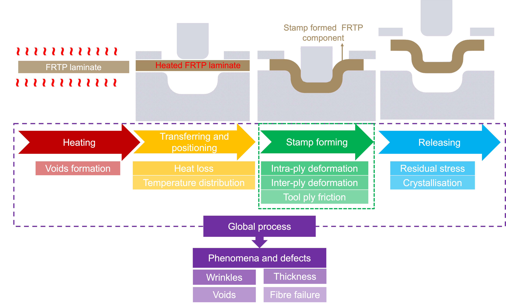
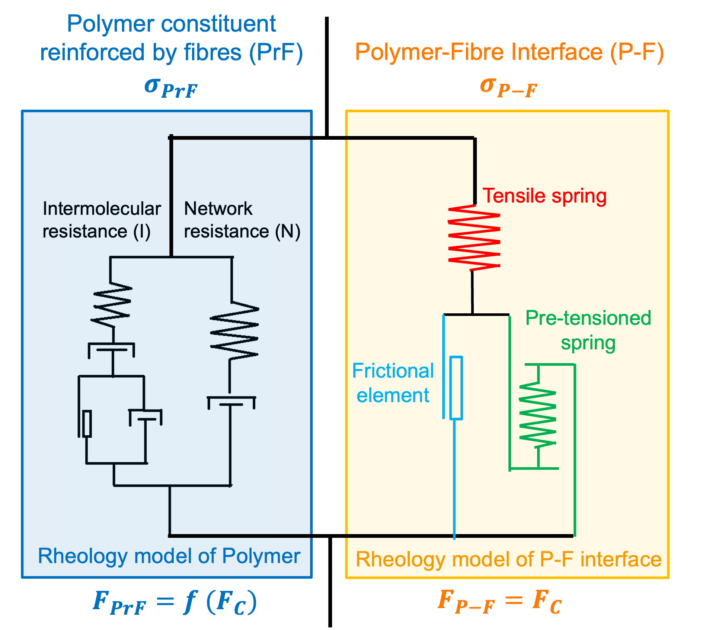

# Imperial College London — PhD Research

💼 Postgraduate Researcher in Computational Modelling of Material Processing  
📍 London, UK  
🗓️ Oct. 2018 – Jul. 2023

Predictive modelling of material behaviour and manufacturing process optimisation for fibre-reinforced thermoplastics, validated experimentally through stamp-forming trials, DIC measurements, and CT scanning.

  

---

## Advanced Experimental Characterisation & Novel Data Analysis Algorithms

- **Bespoke Digital Image Correlation (DIC) Development:** Pioneered a DIC technique integrated with bespoke MATLAB image-processing algorithms to capture high-fidelity deformation data. This addressed the technical challenge of "unrecognizable excessive strain" in semicrystalline thermoplastics during solid-state deformation.
- **Systematic Thermomechanical Analysis:** Conducted comprehensive uniaxial tensile and V-Notched Rail (VNR) shear testing on high-performance polymers (PA6 and PEEK) and carbon fibre reinforced thermoplastics (UD CF/PA6).
- **Mechanism Identification:** Quantified the significant effects of temperature and adiabatic heating on elastic moduli, yield stresses, and strain-hardening behaviours, identifying non-negligible thermal softening during high-rate deformation.
- **Error Correction Methodology:** Proposed and validated a two-step correction method for VNR shear tests, identifying rotation and non-uniformity factors as critical sources of error in characterising material effective stress-strain properties.

## Experimental Techniques

All of the testing, laminate manufacture and forming trials below were carried out by me. Details are in the publications listed on the [main page](../README.md).

**Thermo-mechanical characterisation**
- **Materials:** thermoplastics (PA6, PEEK) and carbon fibre-reinforced thermoplastics (UD CF/PA6, CF/PEEK).
- **Tests:** uniaxial tensile tests (based on ASTM D638), transverse tensile tests, and V-notched rail (VNR) shear tests (based on ASTM D7078).
- **Conditions:** temperatures from the solid state up to near the melting point, and strain rates from 0.001 to 50 /s.
- **Equipment:** Instron 5584 and 3369 machines for low-rate tests, and an Instron VHS servo-hydraulic machine for high-rate tests, each fitted with an environmental chamber. Specimen temperature was monitored with thermocouples and a data logger.
- **Bespoke test rig:** designed and manufactured a titanium-alloy VNR shear rig that fits inside the environmental chamber and keeps its strength at the test temperatures.

**Full-field strain measurement**
- In-house digital image correlation (DIC) with a low-speed camera and a 500 fps high-speed camera, plus custom MATLAB image processing for the very large strains that standard DIC could not track.
- Identified specimen rotation and strain non-uniformity as the main errors in VNR shear tests at large deformation, and proposed a two-step correction method ([preprint](https://doi.org/10.31224/2340)).

**Laminate manufacture**
- Hand lay-up of UD thermoplastic prepregs into cross-ply and ply-blocked laminates, consolidated in an in-house designed and built hot press (250 ± 10 °C).
- Checked consolidation quality with ultrasonic C-scan (Sonatest Prisma TOFD).

**Stamp-forming trials**
- Dome forming of UD CF/PA6 on a 250 kN high-rate forming machine: blanks heated in a furnace and transferred to room-temperature tools in about 8 s. The furnace set point was calibrated against the actual forming temperature using thermocouples embedded in a calibration laminate.
- Designed and manufactured the forming tools. Where fittings, heating or load-bearing parts failed in service, I analysed the cause and updated the design.
- Contributed to one-shot forming trials of fibre–metal laminates (CF/PEEK with 22MnB5 ultra-high-strength steel), which combine forming, bonding and quench hardening in a single step.

**Inspection and defect analysis**
- Optical microscopy of surface defects, and X-ray computed tomography (DeskTom 150, 40 μm voxels) to find internal delamination in formed parts.
- Compared the formed parts with FE predictions: the model reproduced the global dimensions to within 1.6–9.9% and captured the main wrinkle regions. CT also showed that the part with the cleanest surface was not the one with the best internal quality.

**Earlier work: incremental sheet forming (M.Sc., Shanghai Jiao Tong University)**
- Developed "squeezing" and "reverse bending" tool strategies to reduce springback in double-sided incremental forming of AA7075 aluminium sheet, validated by experiments on a DSIF prototype and by FE simulation.

## Constitutive Modelling & Algorithm Development

- **Multi-Scale Unified Models:** Developed novel, physically based viscoelastic-viscoplastic constitutive models that correlate microstructural evolution with macro-scale intermolecular and network responses.
- **Stochastic Consideration:** Engineered the model to unify micro-scale physical mechanisms with macro-scale phenomena while accounting for fibre distribution uncertainties at the meso-scale.
- **Thermo-Mechanical Coupling:** Included adiabatic heating in the models, so that the temperature rise during fast deformation, and the softening it causes, is part of the predicted rate dependency.
- **Complex State Prediction:** Successfully captured stress-strain behaviours under solid-state and near-melt conditions, specifically exploring the polymer-fibre (P-F) interface properties at temperatures approaching the polymer melting point.
- **Parameter Calibration:** Calibrated the 36 model parameters against the test data by least-squares (MSE) optimisation, then refined them by hand where the optimum was not physically sensible.

  

## Machine Learning Surrogate for Micro-Scale Simulation

Published in *Materials & Design* (2024): [DOI 10.1016/j.matdes.2024.112849](https://doi.org/10.1016/j.matdes.2024.112849). I worked on every stage of this study with the first author.

- **The problem:** The effective properties of a composite depend on the random arrangement of fibres in its microstructure. Capturing this with representative volume element (RVE) simulations needs thousands of FE runs, and they must all be repeated for every new material or temperature.
- **Statistically controlled dataset:** A Python algorithm generated 2,000 random "base" microstructures and five slightly perturbed variants of each (10,000 in total). Two-point correlation functions and the structural similarity (SSIM) index confirmed that the variants keep the statistics of their base. All 10,000 RVEs were simulated in Abaqus under transverse tension through automated scripts.
- **CNN surrogate:** A convolutional neural network takes the microstructure image and predicts its full stress-strain curve. With 9-fold cross-validation it reached about **3% mean absolute percentage error** on unseen microstructures, comparable to the scatter caused by the small fibre perturbations themselves.
- **Physics for generalisation:** A new microstructure-factored constitutive model separates the effect of the microstructure from the effect of the constituent materials. Combined with the CNN, it predicts the response for new matrix materials and temperatures from **one** extra simulation instead of a new set of 10,000, while keeping the error around 3%.

## Numerical Implementation & Process Simulation

- **High-Performance Subroutine Coding:** Implemented complex constitutive laws into commercial Finite Element Analysis (FEA) software (ABAQUS) via custom-coded Fortran VUMAT subroutines.
- **Predictive Defect Analysis:** Conducted numerical simulations for dome-shaped demonstrator components to analyse intra-ply deformation and predict potential manufacturing defects such as surface wrinkles and cracks.
- **Process Optimisation:** Leveraged simulation data to identify optimal "forming windows," optimising critical parameters including blank shape design, layer-blocking configurations, and forming temperatures.

  

## Applied Engineering & Intellectual Property

- **Demonstrator Prototyping:** Validated fundamental research through successful stamp-forming trials of complex-shaped UD FRTP components, with results confirmed via visual analysis, microstructural observation, and CT scanning.
- **Innovation in Thermal Processing:** Developed novel induction and resistance heating methods for CFRTPs, leading to successful funding from the Royal Society and a pending patent through the Imperial College patent team.
- **Tooling Design:** Designed and manufactured advanced composite thermoforming and stamp-forming tools with thermo-strength validation, suitable for warm-tool forming processes.
- **Economic Impact:** Demonstrated the potential for solid-state stamp forming to reduce cycle times and energy consumption, facilitating the adoption of UD FRTPs for mass production in the automotive and transportation industries.

---

[⬅ Back to main page](../README.md)
