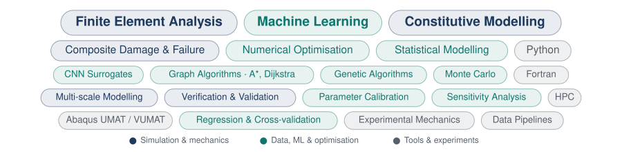
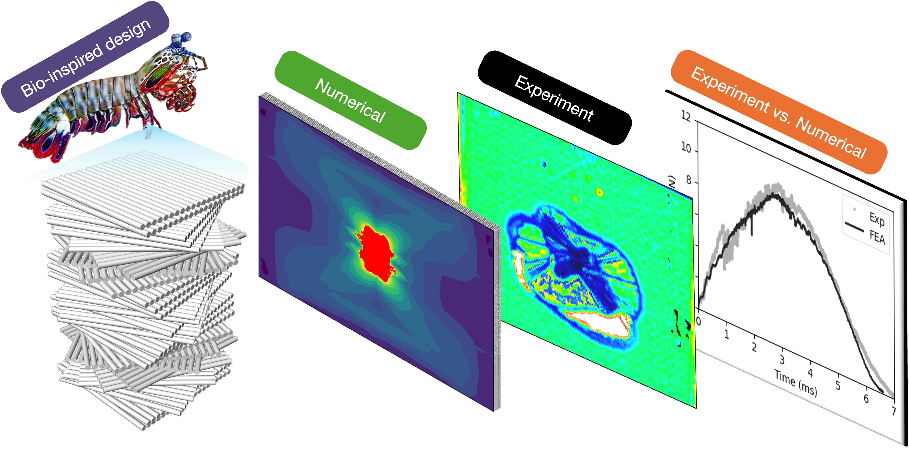
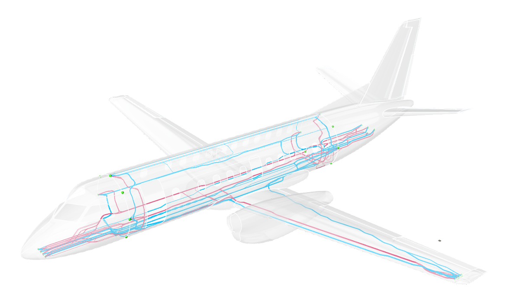
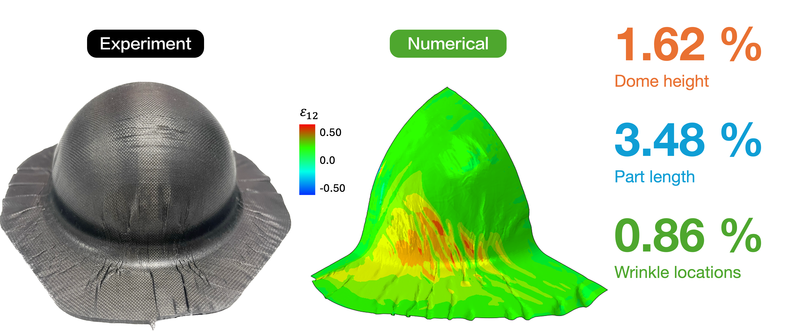
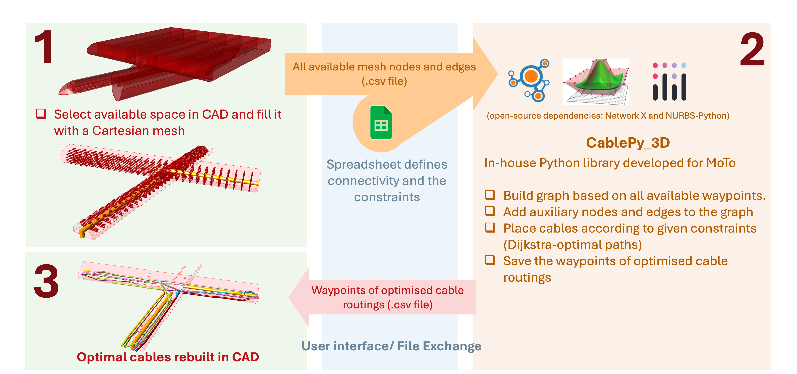
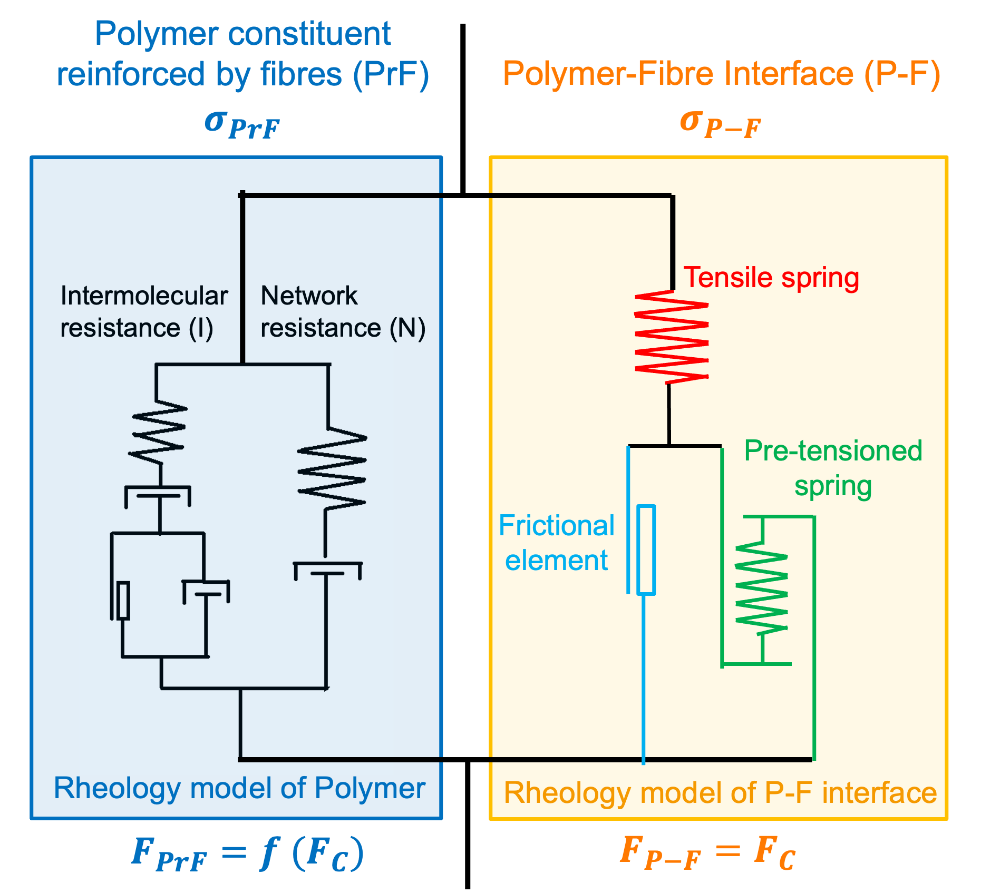

<!-- BANNER: replace with your own simulation image, e.g.

-->

  <picture>
    <source media="(prefers-color-scheme: dark)" srcset="Documents/design/header-dark.svg">
    
  </picture>

Research Associate at Imperial College London · London, UK

  
  
  
  

  <picture>
    <source media="(prefers-color-scheme: dark)" srcset="Documents/design/keywords-dark.svg">
    
  </picture>

  
  
  
  
  

---

## Professional Experience

<table>
<tr>
<td width="42%"></td>
<td>
<b>Research Associate, Simulation &amp; Computational Modelling Engineer</b> 
Imperial College London · Short Brothers (Spirit AeroSystems, ATI project) &amp; Airbus 
📍 London, UK · 🗓️ Nov. 2024 – present
<ul>
<li>Nonlinear composite damage modelling: impact and compression after impact</li>
<li>Re-architected Fortran failure model, <b>60% faster</b>; automated V&amp;V pipeline</li>
<li>Bio-inspired laminates with up to <b>22% higher CAI strength</b> in tests</li>
</ul>
<a href="Imperial_College_London_RA/ImperialCollegeLondon_RA.md">Read more →</a>
</td>
</tr>
<tr>
<td width="42%"></td>
<td>
<b>Research Fellow, Digital Design Engineer</b> 
University of Southampton · Airbus 
📍 Southampton, UK · 🗓️ Nov. 2023 – Nov. 2024
<ul>
<li>Graph-based routing of aircraft cables through 3D CAD geometry</li>
<li>Installation sequence as a constrained TSP, <b>3.5% lower system mass</b></li>
<li>Interactive Dash tool delivered to Airbus engineers</li>
</ul>
<a href="University_of_Southampton_RA/University_of_Southampton_RA.md">Read more →</a>
</td>
</tr>
<tr>
<td width="42%"></td>
<td>
<b>PhD Researcher, Computational Modelling of Material Processing</b> 
Imperial College London 
📍 London, UK · 🗓️ Oct. 2018 – Jul. 2023
<ul>
<li>Thermo-mechanical testing, in-house DIC and stamp-forming trials</li>
<li>Multi-scale constitutive models implemented as Abaqus VUMATs</li>
<li>CNN surrogate for composite stress–strain curves (~3% error)</li>
</ul>
<a href="Imperial_College_London_phd/phd.md">Read more →</a>
</td>
</tr>
</table>

<b>More figures</b>

 

**CablePy development flowchart**

**Constitutive model for CFRPs with multi-scale mechanisms and stochastic features**

**Fortran VUMAT subroutine structure**

**Lloyds Banking Group: Credit Risk Data Science Challenge** 
Exploratory analysis of an 18,000+ record loan dataset; Logistic Regression, Random Forest and XGBoost default-risk models compared by Gini coefficient. [View repository →](https://github.com/Hongyan-Wang/LLoydsBankingGroup_CareerChallenge)

<a href="#top">↑ back to top</a>

---

## Education

| Degree                               | Institution                                   | Dates                 | Notes                     |
| ------------------------------------ | --------------------------------------------- | --------------------- | ------------------------- |
| Ph.D. Mechanical Engineering         | Imperial College London                       | Oct. 2018 – Jul. 2023 | Full scholarship (~£140K) |
| M.Sc. Material Science & Engineering | Shanghai Jiao Tong University                 | Oct. 2015 – Mar. 2018 | GPA: 3.7/4.0 (top 10%)    |
| B.Sc. Material Science & Engineering | Huazhong University of Science and Technology | Oct. 2011 – Jun. 2015 | GPA: 3.9/4.0 (top 2%)     |

<a href="#top">↑ back to top</a>

---

## Publications

**Selected**
1. H. Wang, Z. Ding, X. Chen, H. Liu, N. Li, Experimental characterisation and constitutive modelling of the intra-ply tensile and shear properties of unidirectional fibre reinforced thermoplastics (UD FRTPs) under solid-state stamp forming conditions. *Composites Part A: Applied Science and Manufacturing* 179 (2024): 108034.  
2. H. Wang, H. Liu, Z. Ding, N. Li, Experimental and constitutive modelling studies of semicrystalline thermoplastics under solid-state stamp forming conditions. *Polymer*, 2021. 228: p. 123939.  
3. Z. Ding, H. R. Attar, H. Wang, et al., Integrating Convolutional Neural Network and constitutive Model for Rapid Prediction of Stress-Strain Curves in Fibre Reinforced Polymers: A Generalisable Approach. *Materials & Design*, 241, 112849.  

<b>Conferences & Symposia (5)</b>

1. H. Wang, E. Kazemi, S. T. Pinho, A. Passariello, L. Mencattelli, O. Walsh, 2026, From Impact to Residual Strength: Physics-based Failure Simulation as a Foundation for Composite Aircraft Design and Optimisation. Poster, *Accelerating the Aerospace Development Cycle: From Concept to Flight* symposium, Science Museum, London, UK.
2. H. Wang, E. Kazemi, S. T. Pinho, A. Passariello, L. Mencattelli, O. Walsh, 2026, Design and FEA of Bio-inspired Carbon Fibre-Reinforced Polymer (CFRP) Laminates for Improved Low-Velocity Impact (LVI) Damage Tolerance. The 22nd European Conference on Composite Materials (ECCM22). Oslo, Norway. 
3. H. Wang, E. Kazemi, S. T. Pinho, A. Passariello, L. Mencattelli, O. Walsh, Finite Element Analysis of Low-Velocity Impact (LVI) Damage in Bio-inspired Helicoid CFRP Laminates for Thin- and Thick-Wall Structures. International Conference on Textile Composites (TexComp). Bristol, UK. 
4. H. Wang, E. Kazemi, S. T. Pinho, 2025, Finite element analysis (FEA) of bio-inspired helicoid carbon fibre-reinforced polymers (CFRPs) under Low-Velocity Impact (LVI). The 10th ECCOMAS Thematic Conference on the Mechanical Response of Composites. Vienna, Austria.
5. H. Wang, A. Sobester, 2024, Modelling of Tomorrow — First steps towards an automated cabling framework. Physical Workshop Decision Making & Optimization, Toulouse, France.

<b>Journal Articles (9)</b>

1. H. Wang, Z. Ding, X. Chen, H. Liu, N. Li, Experimental characterisation and constitutive modelling of the intra-ply tensile and shear properties of unidirectional fibre reinforced thermoplastics (UD FRTPs) under solid-state stamp forming conditions. *Composites Part A: Applied Science and Manufacturing* 179 (2024): 108034.  
2. H. Wang, H. Liu, Z. Ding, N. Li, Experimental and constitutive modelling studies of semicrystalline thermoplastics under solid-state stamp forming conditions. *Polymer*, 2021. 228: p. 123939.  
3. H. Wang, Z. Ding, Z. Shao, H. Liu, N. Li, Error analysis of stress-strain characterisation using V-Notched Rail shear test for sheet materials subject to large simple shear deformation. Preprint, *engrXiv*, 2023.  
4. H. Wang, Z. Ding, Z. Shao, C. Gao, H. Liu, N. Li, Solid-state stamp forming of UD CF/PA6: Forming window and defect evolution. Preprint, *engrXiv*, 2026.  
5. Z. Ding, H. R. Attar, H. Wang, et al., Integrating Convolutional Neural Network and constitutive Model for Rapid Prediction of Stress-Strain Curves in Fibre Reinforced Polymers: A Generalisable Approach. *Materials & Design*, 241, 112849.  
6. Z. Ding, H. Wang, J. Luo, N. Li., A review on forming technologies of fibre metal laminates. *International Journal of Lightweight Materials and Manufacture*, 2021. 4(1): p. 110-126.  
7. Z. Ding, H. Wang, C. Gao, N. Li, A novel one-shot forming technology for ultra-high strength multi-material structures: Process design, simulation and proof of concept. *Composites Part A: Applied Science and Manufacturing* 210 (2026): 110105.  
8. R.A. Brooks, H. Wang, Z. Ding, et al., A review on stamp forming of continuous fibre-reinforced thermoplastics. *International Journal of Lightweight Materials and Manufacture*, 2022. 5(3): p. 411-430.  
9. H. Wang, R. Zhang, H. Zhang, Q. Hu, J. Chen, Novel strategies to reduce the springback for double-sided incremental forming. *The International Journal of Advanced Manufacturing Technology* 96 (2018): 973–979.  

<b>Patents (1)</b>

1. N. Li, Z. Ding, H. Wang, C. Gao, Method of manufacturing multi-material structures. International patent application [WO 2026/132777 A1](https://patentscope.wipo.int/search/en/WO2026132777), published 25 June 2026 (priority GB, 17 December 2024). 

<b>PhD Thesis (1)</b>

1. H. Wang, 2023, Fundamental studies on solid-state stamp forming of unidirectional fibre reinforced thermoplastics for automobile components. PhD thesis, Dyson School of Design Engineering, Imperial College London. Supervisors: N. Li, P. Childs, J. Lin.  

<a href="#top">↑ back to top</a>

---

## Skills

**Programming & Software Engineering:** Python, Fortran, MATLAB, C/C++, Git, automated testing pipelines, CLI tooling 

**Quantitative Methods & Algorithms:** numerical optimisation, parameter calibration, combinatorial optimisation (genetic algorithms, TSP), graph search (A*, Dijkstra), constraint modelling, stochastic and statistical modelling, Monte Carlo sampling, sensitivity analysis  

**Machine Learning & Data Analysis:** CNN surrogate models for simulation, physics-informed regression, predictive modelling (logistic regression, random forest, XGBoost), cross-validation and model evaluation (leave-one-out, Gini/AUC), exploratory data analysis, validation against experimental data  

**Libraries & Frameworks:** NumPy, Pandas, SciPy, scikit-learn, XGBoost, NetworkX, Plotly, Dash 

**Engineering & Simulation Tools:** Abaqus (UMAT/VUMAT), Rhino/Grasshopper, HPC workflows

<a href="#top">↑ back to top</a>

---

## Beyond Work

| | |
|---|---|
| 💡 Tech and business development | 🎭 Literature and theatre (can recite Chekhov's *The Seagull* and *Three Sisters*) |
| 🤔 Philosophy (would Effective Altruism be enough for the post-modern existential crisis?) | 🎨 Digital design ([samples](Documents/DigitalArtSample.png)) |
| 🕵️ Spy stories (who is the **craziest** in history?) | 🎻 Classical music and opera |

<a href="#top">↑ back to top</a>

