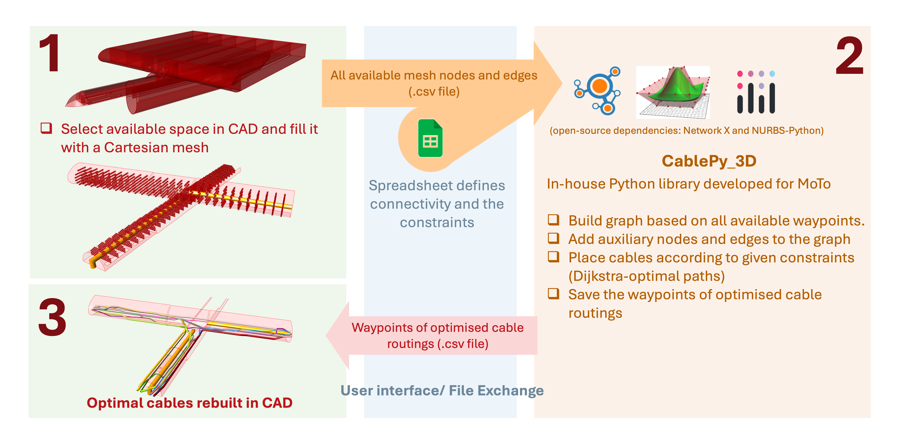
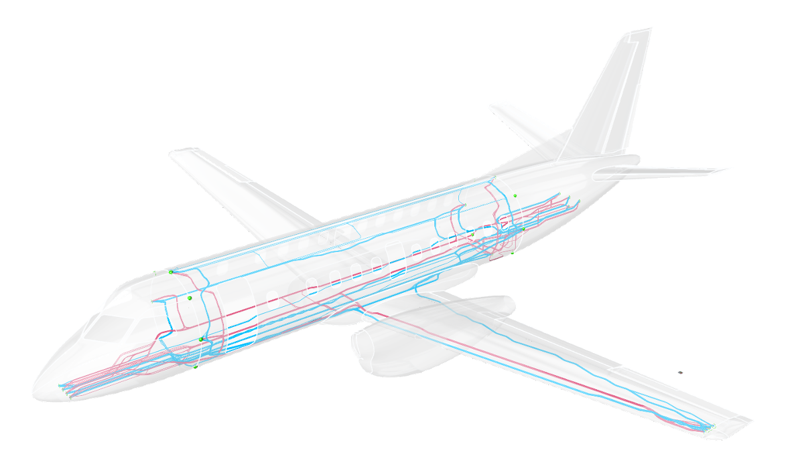

# University of Southampton — Research Fellow

**Industry Collaborator:** Airbus  
💼 Research Fellow, Digital Design Engineer  
📍 Southampton, UK  
🗓️ Nov. 2023 – Nov. 2024

Graph-based routing and combinatorial optimisation for automated aircraft cable layout.

  

---

## Algorithmic Pathfinding & Graph Theory

- **3D High-Density Discretisation:** Discretised complex 3D aeronautical geometries using Rhino/Grasshopper (3D modelling) into mathematical graphs using Python and NetworkX. Managed a high-resolution search space, integrating orthogonal, face-diagonal, and cubic-diagonal vectors to maximise path precision.
- **Multi-Objective Spatial Optimisation:** Programmed a custom search engine utilising A* and Dijkstra algorithms to minimise a global cost function. The logic optimised for minimal cable weight (path length) while simultaneously navigating dense regulatory and structural constraints.
- **NURBS-Based Geometric Synthesis:** Developed a novel algorithm utilising Non-Uniform Rational B-Splines (NURBS) to interpolate discrete paths into physically realistic 3D geometries. Integrated control laws to enforce outlet/inlet vector alignment and ensure strict adherence to minimum bending radius constraints based on cable physical properties.
- **Production-Scale Graph Construction:** Scaled the routing graph from early prototype grids to a full engine-pylon case of **253,239 nodes / 2,539,193 edges**, and a whole-airframe demonstrator routing **400 cables** (100 power + 300 signal) simultaneously.

## Performance Engineering & Algorithm Benchmarking

- **Complexity-Driven Algorithm Selection:** Benchmarked Dijkstra, A*, and Bellman-Ford empirically across multiple mesh resolutions, reasoning explicitly about adjacency-list (O(E·log V)) vs. adjacency-matrix (O(V²)) implementations to select the fastest approach for large sparse graphs.
- **Bottleneck Diagnosis & Refactor (~26x speedup):** Identified that per-constraint edge-weight recomputation degraded to **~18.4s per cable** once separation constraints scaled to hundreds of cables; diagnosed the redundant per-constraint recomputation as the root cause and rewrote the logic to batch all constraint contributions into a single potential-field update pass, reducing runtime to **~0.7s per cable**.
- **Graph-Build Optimisation:** Profiled and restructured graph-construction logic to prune out-of-bound nodes early, cutting build time for a representative wing-section graph from **72.1s to 28.8s**.

## Combinatorial Optimisation & Constraint Logic

- **Genetic Algorithm (TSP) Implementation:** Modelled the cable installation sequence as a Constrained Traveling Salesman Problem (TSP). Benchmarked permutation-based genetic algorithms (NSGA-II via the DEAP framework) against gradient-based methods (conjugate gradient, BFGS, Nelder-Mead, trust region, Powell), validating solution quality with Monte Carlo studies of 10,000+ random permutations before selecting the GA approach, achieving a **3.5% reduction in total system mass**.
- **Dynamic Rule & Penalty Enforcement:** Translated qualitative aerospace regulations (incl. CS 25.1701 wiring-separation requirements) into quantitative penalties. Used KD-Tree spatial indexing (`scipy.spatial.KDTree`) for rapid nearest-neighbour queries over large irregular 3D meshes to enforce "Separation" (redundancy safety) and "Harnessing" (structural affinity/bundling) in real-time.
- **Geometric Packing Solver:** Developed a solver based on Welzl's "Smallest Enclosing Circle" algorithm to dynamically calculate bundle diameters. Implemented recursive splitting logic that triggers when a bundle diameter exceeds structural rib aperture limits.
- **Environmental Heat Avoidance:** Engineered thermal sensitivity logic that dynamically increases graph edge weights near "Hot Zones" (e.g., engines) to steer automated routing toward safer thermal environments.

## Software Architecture & System Integration

- **Object-Oriented Library Design:** Designed a `Cable` class encapsulating path, constraints, and violation state with associated behaviour (pathfinding, constraint checking, visualisation), later extended via inheritance into a `CablePy_3D` subclass adding wall-separation and bending-radius attributes on top of the base `CablePy_2D` implementation.
- **Cross-System Data Contract:** Defined and maintained a versioned CSV data interchange schema (mesh geometry, cable waypoints, structure-item mapping) to keep the Python routing library in sync with an independently developed Grasshopper/CAD tool, enabling near-real-time round-trip updates between the two systems.
- **Cross-Platform Validation:** Benchmarked and validated the codebase on both macOS (Apple Silicon) and Windows.
- **Technical Handover Documentation:** Authored a complete internal handover deck (module walkthrough, class definitions, algorithm rationale) at project close to support continuity beyond the project.

## Visualisation & Interactive Systems

- **Full-Stack Optimisation Dashboard:** Developed a web-based interactive interface using Plotly and Dash to visualise 3D graph networks and pipe-rendered cable paths. Built a "click-and-trace" mechanism for real-time inspection of bundle thickness and cable metadata.
- **Human-in-the-Loop Sensitivity Interface:** Created a parametric interface allowing users to manipulate optimisation weights (e.g., prioritising harnessing vs. separation) and instantly visualise the impact on the global routing solution.

  

---

[⬅ Back to main page](../README.md)
